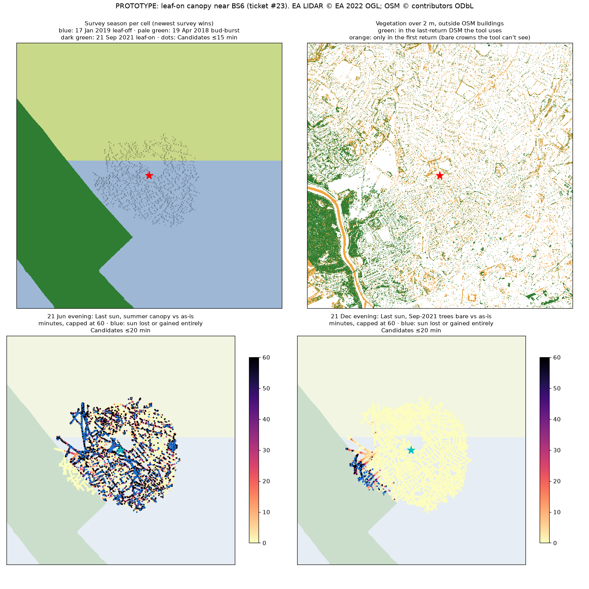

# PROTOTYPE: leaf-on canopy near BS6 (throwaway, never merged)

Question: [How much does leaf-on tree canopy change winter answers in Bristol?](https://github.com/epabarker/daylight-viewing/issues/23)



## The premise flips

The ticket assumed the EA 2022 composite DSM is mostly leaf-on, so it would show trees as solid in winter. Near BS6 that isn't so:

- **The composite keeps the newest survey per cell.** This was checked on ST5575, where the composite matches the 21 Sep 2021 per-survey tile on 92–100% of cells, and overwrites the 23 Jan 2019 survey where they overlap.
- **Within the study box (home ± 4.8 km), 13% of cells are leaf-on** (flown 21 Sep 2021, a strip about 2–4 km west over the Avon gorge and Leigh Woods). The rest were flown on 17 Jan 2019 (the south half, home included) or 19 Apr 2018 (the north half, at bud-burst). Flight dates are in each tile's `*_Metadata.gpkg`, layer `lidar_used_in_merging_process`.
- **A leaf-off last return passes through bare crowns.** The same trees were flown on 23 Jan 2019 and 21 Sep 2021 (3.2 km² overlap). Only 23% of leaf-on crown cells are still taller than 2 m in January, and their median height is 0.18 m in January against 12.3 m in September. 87% of them lose more than half their height.
- **The same holds on the surveys that cover home.** The last-return DSM keeps only 32% (17 Jan 2019 NLP, 40 km²) and 36% (19 Apr 2018 NLP, 38 km²) of the cells the first return shows as vegetation, against 79% where the survey was leaf-on (21 Sep 2021). See `results/retention_under_crown.json`.

So the tool's DSM mostly shows deciduous trees as **absent**: not as bare, and not as in leaf. Two consequences:

- **Leaf-on season (about May to October):** the as-is answers are too optimistic, and by a lot. This is the main finding.
- **Winter:** the as-is answer is the **optimistic end of a bracket**, not the truth. Low sun through bare branches is partly blocked and dappled, and the DSM shows no branches at all.

## Surfaces compared

| surface | what it models |
|---|---|
| `asis` | the composite DSM the tool uses |
| `bare_on` | vegetated cells set to DTM only where the survey was leaf-on (May–Sep). **This is the winter correction actually needed.** |
| `bare_all` | every vegetated cell set to DTM. An upper bound; it also removes evergreens and hedges, which stay in winter. |
| `leafy` | summer proxy. In leaf-off-surveyed cells, vegetation is raised to the first-return height (first returns hit bare branches, so they trace the crown envelope). |

Vegetation means DSM − DTM over 2 m, outside OSM building footprints buffered by 1.5 m. Every profile merges EA 1 m (3 km) with the far field from OS Terrain 50 (3–50 km), is cast at grid azimuth from true azimuth, and covers 40–320° at 0.25°. Scoring follows the decided Stage 1 rules: Wake time 07:00, Morning and Evening windows, sun counts above any-sign horizons, openness cut-off 0.75, rank by low-sun minutes then nearest, 200 m de-dupe. There are 16,609 Candidates within a 20 min walk, 8,847 of them within 15 min.

**The summer proxy is validated against real leaf-on data.** On 5.6 km² where the Sep 2021 survey overlaps the 17 Jan 2019 NLP survey, the leaf-off first-return crowns match the leaf-on last-return crowns with IoU 0.70, recall 85% and precision 80%. The median height difference is −0.01 m. See `results/proxy_validation.json`.

## Effect size (15 min max walk; 20 min in `results/results_walk20.md`)

"Shift" is how many minutes the as-is answer is off, in the expected direction: first sun in the morning, Last sun in the evening. It is measured over reachable open spots with sun under both surfaces.

**Winter, part 1: the leaf-on strip (`bare_on`, Nov–Mar). Negligible.**
- Morning: **0 min**, on every date.
- Evening: mean 0.1–0.3 min; 1–2% of spots shift by 5 min or more.
- No openness changes; top-5 leave-by within 0–2 min.
- At 20 min max walk the leaf-on strip comes into reach: on 21 Dec evening the mean is 2.8 min, 7% of spots shift by 5 min or more, about 100 spots cross 0.75 openness, and top-5 leave-by moves within 1 min.

**Winter, part 2: bare branches. Bracketed, not measured.** The as-is answer treats bare crowns as fully open. The `leafy` surface on winter dates treats them as fully opaque. The truth lies between, depending on how much direct sun a bare deciduous crown lets through. This prototype doesn't measure that, and it is the open input for the canopy decision.

| date | window | as-is ↔ opaque-branches: mean / p90 shift | spots ≥5 min off | top-5 leave-by off (min) |
|---|---|---|---|---|
| 21 Dec | morning | 9 / 32 | 33% | 0, 5, 2, 0, – |
| 21 Dec | evening | 13 / 47 | 31% | 1, –, –, 27, 56 |
| 5 Feb | evening | 18 / 68 | 35% | 0, –, 14, 11, 3 |
| 20 Mar | morning | 14 / 55 | 29% | 102, 12, 32, 99, – |

**Summer error (`leafy`, leaf-on season), the as-is answer being optimistic:**

| date | window | mean / p90 shift, open spots | spots ≥5 min off | open spots that drop below 0.75 | top-5 leave-by off (min; "–" = no sun at all) | as-is #1's share of the true best |
|---|---|---|---|---|---|---|
| 15 May | morning | 13 / 52 | 24% | 1,591 of 6,794 | –, 0, 0, –, 7 | 0 |
| 15 May | evening | 34 / 123 | 40% | 1,690 of 6,399 | 3, 35, –, 4, 14 | 0.80 |
| 21 Jun | morning | 12 / 52 | 22% | 1,580 of 6,758 | 0, 0, 0, 0, 0 | 1.00 |
| 21 Jun | evening | 38 / 132 | 41% | 1,710 of 6,406 | 6, 16, 8, –, 0 | 0.63 |
| 22 Sep | morning | 13 / 49 | 31% | 1,562 of 6,921 | 1, 38, 0, 0, 0 | 0.93 |
| 22 Sep | evening | 27 / 100 | 36% | 1,648 of 6,490 | 1, –, 72, 11, 237 | 1.00 |
| 15 Oct | morning | 11 / 42 | 32% | 1,553 of 6,952 | 24, –, 0, 20, 6 | 0.72 |
| 15 Oct | evening | 23 / 86 | 36% | 1,600 of 6,507 | 25, 33, 9, 5, 13 | 0.92 |

About a quarter of the spots the tool calls open are tree-enclosed in leaf, and the tool sends people there. The top-5 lists change on most leaf-on dates.

`bare_all` (an upper bound for anything tree-shaped) shifts open spots by a mean of 4–14 min. It leaves the top-5 leave-by unchanged, because top spots are already open. About 600–900 points would cross 0.75 openness. This is the evergreen and hedge component, not a seasonal one.

## Candidates under a crown

12.5% of reachable Candidates within 15 min (1,104 of 8,847; 11% within 20 min) stand where the first return shows a crown over 2 m. The open-ground filter (last-return DSM − DTM ≤ 1 m) passes them because the last return sees through bare branches. In leaf, the tool would send people to stand under a tree. Much of the blue "sun lost" scatter on the 21 Jun map is this. **Filtering Candidates on the first return**, not only casting profiles against it, is a second lever for the canopy decision.

## Vegetation masks (the ticket's second bullet)

| mask | how | verdict |
|---|---|---|
| last-return DSM − DTM > 2 m, minus buffered OSM buildings | data already used | Misses bare crowns: recall 36% against EA's VOM on the Apr 2018 survey (precision 81%). |
| **first-return DSM − DTM > 2 m, minus buffered OSM buildings** | `lidar_composite_first_return_dsm`, the same 2022 composite grid, OGL, one more product (about 370 MB zipped for 6 tiles) | **IoU 0.82 against VOM, recall 99%, precision 82%.** This is the one to use. |
| EA NLP Vegetation Object Model | `national_lidar_programme_vom`, 2018/2019 only | Not a composite, so it doesn't follow the newest-survey rule, and it has gaps. Useful as a check, not as a source. |
| OSM buildings alone | in the Geofabrik `.pbf` already planned | Needed to keep building edges out of either mask. |

Known artefact: tidal water (the Avon) shows as first-return "vegetation". A water mask from OSM would remove it.

## What this means for [Leaf-on canopy: correct it, caveat it, or ignore it?](https://github.com/epabarker/daylight-viewing/issues/24)

- "Correct" now means **adding** canopy for the leaf-on season (or picking per season), not making trees transparent in winter. Removing leaf-on canopy in winter matters only where the survey was leaf-on, which in Bristol is a strip at the west edge of a 20 min walk.
- **Open input:** how opaque bare deciduous crowns are to low direct sun. The winter answer sits between as-is (fully open) and opaque branches. The gap is up to tens of minutes at some top-5 spots.
- **Second lever:** drop Candidates under a first-return crown, at least for the leaf-on season.
- Survey season is free per cell from the tile metadata, so a build can tell which cells need which treatment.
- A seasonal correction implies a second profile set (or a per-cell seasonal delta) in the tiles, and the first-return product as a new build input for [Data refresh: what triggers a new data build, and how is it cut and shipped?](https://github.com/epabarker/daylight-viewing/issues/19).
- Stage 2+ caveat: the leaf-on/leaf-off mix is a Bristol fact. Other areas will have other survey seasons.

## Run

From the main checkout root (needs `data/dsm`, `data/dtm`, `data/farfield/terr50`; downloads go to the gitignored `data/canopy/`):

```sh
# Geofabrik bristol/gloucestershire/somerset .pbf, EA first-return composite x6,
# per-survey 2019/2021 DSM and NLP VOM for ST5575, NLP 2019 first return for ST5070/ST5570
uv run --with osmium --with geopandas python $W/prep_osm.py data/canopy/out
uv run --with osmnx --with scipy --with geopandas python $W/build_profiles.py data/canopy/out   # ~5 min, 10 cores
uv run python $W/crowns.py data/canopy/out
uv run python $W/validate_proxy.py data/canopy/out
uv run python $W/analyse.py data/canopy/out 15   # and 20
PYTHONPATH=$W uv run --with matplotlib python $W/figure.py data/canopy/out $W/canopy_map.png
```

Overpass refused osmnx's pinned address on 2026-11-10, so OSM comes from Geofabrik extracts instead.
